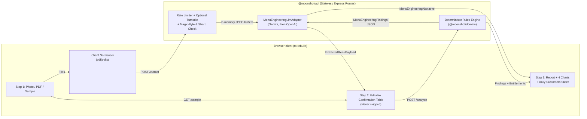

# Menu Engineering & UK Price Benchmark Tool

This document records the architecture for the **Menu Engineering & Price Benchmark Audit** API (`/api/v1/menu-engineering/*`). A skeleton client lives at `/menu-audit` on `@moonshot/marketing` so the landing-page redesign can keep moving. The API, benchmark rules, and model cascade stay.

## 1. Architecture & Data Flow

`/menu-audit` is a text-only skeleton (sample menu, one image upload, analyse). The confirmation table and charts below are the client to rebuild on the finished landing page.

## 2. Strict Boundary & Separation of Concerns

1. **Isolated from POS / Order-Ahead / KDS tables**:
   - All shared contracts live in `packages/types/src/menu-engineering.ts`.
   - All canonical items, UK regional benchmarks, and deterministic rules live in `packages/domain/src/menu-engineering/`.
   - Nothing reads or writes the operational `menu_items`, `orders`, or `cafes` PostgreSQL tables.
2. **Stateless Free Tier (Zero Image Persistence)**:
   - Uploaded menu photos and rendered PDF pages are held strictly in memory (`multer.memoryStorage()`), validated via magic bytes (`file-type`) and `sharp`, passed to the vision adapter, and immediately garbage-collected.
3. **Single Free vs. Paid Entitlement Switch**:
   - `resolveMenuEngineeringEntitlements(tier)` in `packages/domain/src/menu-engineering/entitlements.ts` is the sole switch controlling free-tier capabilities (`canExtractAndAuditPricing: true`) vs. paid-tier Menu Studio capabilities (`canRestructureMenuLayout`, `canRewriteMenuCopy`, `canExportPrintTemplates`, `canSaveAndHostQrMenu`).

## 3. Why Deterministic Rules + Constrained LLM Narration?

- **Vision extraction (`extractMenuFromImages`)**: Multimodal models read skewed chalkboard photos and multi-column layouts into a strict JSON schema (`responseSchema`). Canonical ids stay in the prompt, not the schema: repeating the ~47-value `CANONICAL_ITEM_IDS` enum on every item and modifier makes Gemini reject the request with HTTP 400. `normaliseRawModelExtraction` repairs unknown ids. Provider failures are returned as `ApiHttpError` (sanitised message, provider status, model name) instead of the generic "Internal error" envelope.
- **Confirmation step (`MenuConfirmTable`)**: Always shown before running analysis so the café owner can fix OCR quirks, section names, or canonical mappings.
- **Deterministic math (`analyseMenuAgainstBenchmarks`)**: Every price band comparison (`below_range`, `in_range_low`, `optimal`, `in_range_high`, `above_range`), ladder check (coffee size spread, tight brunch clustering within £2, missing premium brunch anchor, syrup pricing vs 60p–95p benchmark, missing brunch add-on box, overloaded sections >= 9 items), category gross margin estimate, and monthly pound uplift is computed deterministically in TypeScript.
- **Zero-hallucination narration (`narrateFindings`)**: The LLM (or deterministic fallback when `GEMINI_API_KEY` is not set) only turns the structured `MenuEngineeringFindings` JSON into owner-friendly prose. Both the prose report and the 4 visual charts read from the exact same `findings` payload, guaranteeing they never disagree.

## 4. Swapping Vision / Narration Models

`apps/moonshot-api/src/lib/menu-engineering/llm-adapter.ts` defines the provider-agnostic `MenuEngineeringLlmAdapter` interface:

- `extractMenuFromImages(images: MenuImageInput[]): Promise<ExtractedMenuPayload>`
- `narrateFindings(findings: MenuEngineeringFindings): Promise<MenuEngineeringNarrative>`

`GeminiMenuEngineeringAdapter` (`gemini-adapter.ts`) uses `@google/genai`. `OpenAiMenuEngineeringAdapter` (`openai-adapter.ts`) uses the OpenAI chat completions API with a strict JSON schema. Both share the extraction and narration prompts in `prompts.ts`.

`resolveMenuEngineeringLlmAdapter()` (`resolve-adapter.ts`) builds one cascade:

- Provider order is `MENU_ENGINEERING_PROVIDERS` (default `gemini,openai`). A provider with no API key is skipped.
- Each provider contributes up to three models: `GEMINI_MODEL` / `OPENAI_MODEL` first (defaults `gemini-3.8-flash` and `gpt-5.4`), then that provider's fallbacks, unless `GEMINI_MODELS` or `OPENAI_MODELS` replaces the list.
- A retryable failure — overload, unknown model, empty read — tries the next model.
- An auth failure skips the rest of that provider (one shared key) and continues with the next provider.
- If every narration attempt fails, the deterministic narrative is returned. `narrative.modelName` records which model wrote the prose (`openai:gpt-5.4`, `gemini:…`), or null for the fallback.

## 5. Production API origin

`GEMINI_API_KEY`, `OPENAI_API_KEY`, and the model env vars live on `moonshot-api`. Do not put provider keys in the marketing app. `/menu-audit` calls the API from the browser, so that service needs `VITE_API_URL` set to the API origin only (`https://moonshotapi-production.up.railway.app`) and `CORS_ORIGINS` must include the marketing origin. Local `vite` dev falls back to `http://localhost:3000` when `VITE_API_URL` is unset.

A Railway preview of marketing still bakes the service's `VITE_API_URL`, which is usually the production API. The sample route is already there. The browser shows "Failed to fetch" when the preview hostname is not in production `CORS_ORIGINS` — the response is returned, but without `Access-Control-Allow-Origin` the page cannot read it. Add the preview origin (the page prints it) to `CORS_ORIGINS` on the API that `VITE_API_URL` names. OpenAI model choice from this branch is on that API only after it is deployed with `OPENAI_API_KEY`. The page prints the API origin, this page's origin, and the response body so a tablet can show the failure without a console.
